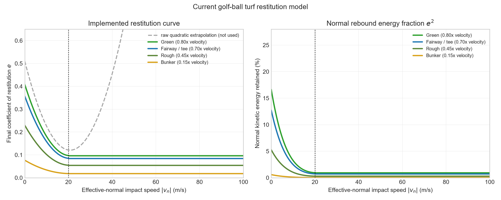
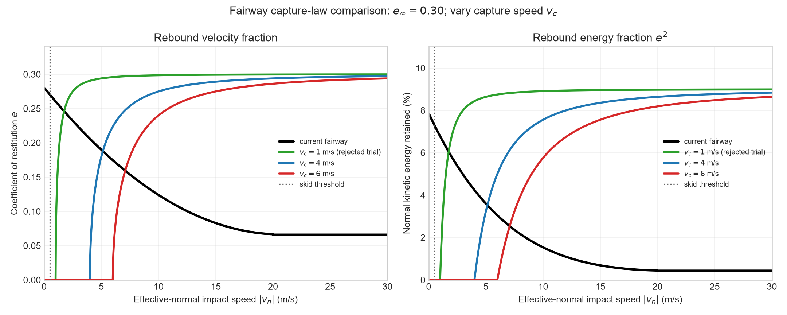

# Bounce and restitution model

The bounce combines three mechanisms:

1. rotate the terrain normal using the effective deformation plane;
2. apply separate normal and tangential restitution in that rotated frame;
3. apply a spin-dependent Coulomb friction impulse, limited by the surface's
   `BOUNCE_FRICTION`, tangent to that frame.

The result is then returned to flight or moved to the ground-constrained skid
phase.
See [`../crater_model/README.md`](../crater_model/README.md) for the effective
plane derivation and [`../SPIN_BOUNCE_AND_SKID.md`](../SPIN_BOUNCE_AND_SKID.md)
for spin coupling and the implemented skid phase.

## Directional restitution

Resolve incoming velocity in the deformation-rotated effective-plane frame,

$$
\mathbf v=\mathbf v_t+v_n\mathbf n_e.
$$

Before spin-dependent friction, the rebound is

$$
\mathbf v_{out}=r_t\mathbf v_t-r_n v_n\mathbf n_e.
$$

`NORMAL_RESTITUTION` controls pop and `TANGENTIAL_RESTITUTION` controls forward
release. Each is a direct per-impact velocity multiplier. Their ratio also
changes the exit angle relative to the effective plane:

$$
\tan\theta_{out}=\frac{r_n}{r_t}\tan\theta_{in}.
$$

| Surface | Normal $r_n$ | Tangential $r_t$ | Normal energy | Tangential energy |
|---|---:|---:|---:|---:|
| Rough | 0.18 | 0.50 | 3.24% | 25.00% |
| Fairway | 0.30 | 0.75 | 9.00% | 56.25% |
| Green | 0.16 | 0.68 | 2.56% | 46.24% |
| Bunker | 0.00 | 0.00 | 0.00% | 0.00% |
| Water | 0.00 | 0.00 | 0.00% | 0.00% |
| Tee | 0.30 | 0.75 | 9.00% | 56.25% |

Bunker restitution and deformation asymmetry are both zero. Loose sand is
treated as a dead, absorbing impact that enters ground-constrained skid rather
than as an elastic rebound from an inclined effective crater plane. Retaining
the old large bunker deformation asymmetry could create an upward ramp even
when restitution was nearly zero, contradicting the intended "plumph" response.

Bounce friction is applied afterward and may still change direction because it
physically exchanges tangential translation and spin. Tangential restitution
represents passive along-plane speed retention; friction represents
contact-point-slip coupling to angular momentum.

These are gameplay-motivated values rather than material measurements. The
green deliberately damps both components enough that an ordinary approach can
bounce once or twice and check instead of behaving like a trampoline or fast
fairway. Its response is a surface rule, not a wedge-specific exception.



This replaces the former Penner-derived normal-only restitution curve. A later
energy-capture experiment with $v_c=1$ m/s was also rejected because its much
larger ordinary-impact rebound looked wrong. Its comparison plot remains as
design history, not active physics.



## Why shallow skips persisted

The former Penner-derived fit coupled two effects: it reduced only normal speed,
which both dissipated energy and made the outgoing trajectory shallower. The
active model makes the roles separately tunable: effective-plane geometry
biases direction, while normal and tangential restitution control component
retention. Their ratio still affects exit angle. The rejected capture-law
experiment showed that simply making normal restitution larger was insufficient.

The first speed-independent deformation model used

$$
\theta_c\propto\sin(2\phi).
$$

Near grazing incidence, let $\epsilon=|v_n|/v_t$. Then both the incoming angle
and the effective-plane tilt were proportional to $\epsilon$. The plane angle
approached zero but remained a finite fraction of the incidence angle, allowing
horizontal velocity to be repeatedly redirected upward. Rough and bunker were
especially affected because their `DEFORMATION_ASYMMETRY` values are larger.

The accepted model instead uses

$$
\tan\theta_c=\tan(15.4^\circ)Q C_s
\frac{\sin^2(2\phi)}{\sin^2(2\times44.4^\circ)}.
$$

Here $Q$ is `DEFORMATION_ASYMMETRY_SCALE`, currently 1.0, and $C_s$ is the
surface multiplier:

| Surface | $C_s$ | Effective tilt near 45° incidence |
|---|---:|---:|
| Rough | 0.30 | 4.7° |
| Fairway | 0.40 | 6.3° |
| Green | 0.35 | 5.5° |
| Bunker | 0.00 | 0.0° |
| Water | 0.00 | 0.0° |
| Tee | 0.40 | 6.3° |

A rejected 4x stress test remains documented in the crater-model analysis.

This vanishes quadratically at both vertical and grazing incidence. The
effective ramp therefore becomes negligible relative to the incoming angle at
both boundaries and is strongest around 45 degrees. The unscaled kernel equals
Haake's 15.4-degree point when the combined global and surface multiplier is
1.0, but the active gameplay multipliers are all below 1.0 and deliberately do
not preserve that calibration on any current surface.

Regression tests cover both asymptotic limits, speed independence, the angular
peak, the active green multiplier, exact vertical impacts, and the directional
restitution decomposition.

## Bounce-to-skid transition and rolling resistance

When rebound velocity normal to the true terrain falls below
`SKID_NORMAL_THRESHOLD = 0.5 m/s`, the simulator transitions to constrained
ground contact. A purely vertical 0.5 m/s hop would rise about 1.3 cm, so this
preserves visibly meaningful hops while avoiding a long tail of tiny late
bounces. Contact-point slip is then resolved during `SKID` before the ideal
`ROLL` phase begins.

On flat ground, rolling deceleration is

$$
a_\mathrm{roll}=-C_r g,
$$

using the current surface values:

| Surface | $C_r$ |
|---|---:|
| Rough | 0.240 |
| Fairway | 0.120 |
| Green | 0.055 |
| Bunker | 8.000 |
| Water | 0.000 |
| Tee | 0.120 |

Rolling resistance is gameplay-calibrated after the bounce and skid models are
in place. Fairway/tee currently use 0.120 and rough 0.240 to permit useful
release; these remain subject to retuning after directional restitution.
Bunker stays at an effective 8.000 because loose sand should plow and settle
rather than establish a meaningful clean roll. Green remains fast at 0.055.

The contact model exposes four independent surface tables. Most surfaces still
use equal starting values for the three friction coefficients, but bunker skid
is deliberately much stronger to approximate sand plowing:

| Surface | Bounce friction | Skid friction | Static friction | Roll resistance |
|---|---:|---:|---:|---:|
| Rough | 0.500 | 0.500 | 0.500 | 0.240 |
| Fairway | 0.430 | 0.430 | 0.430 | 0.120 |
| Green | 0.430 | 0.430 | 0.430 | 0.055 |
| Bunker | 0.700 | 3.000 | 0.700 | 8.000 |
| Water | 0.000 | 0.000 | 0.000 | 0.000 |
| Tee | 0.430 | 0.430 | 0.430 | 0.120 |

`BOUNCE_FRICTION` limits the tangential impact impulse. `SKID_FRICTION`
controls sustained sliding and spin/translation exchange on the ground.
`STATIC_FRICTION` determines whether a no-slip roll can be maintained on the
local slope. `ROLL_RESIST` removes speed only after the ball is cleanly rolling.
The bunker values are effective coarse-grained resistance parameters rather
than literal Coulomb measurements: the simple phase model does not explicitly
simulate penetration, displaced sand, or a partially buried ball.

## Remaining limitations

- Speed-independent directional restitution is a gameplay model, not a measured
  turf constitutive law; extreme-speed penetration and damage remain absent.
- The instantaneous model omits finite normal and tangential turf compliance.
- Low rebounds transition to a ground-constrained skid phase. Pure rolling
  begins only after contact-point slip falls below 0.05 m/s.
- The three friction tables are independently tunable. Their values remain
  gameplay fiducials rather than independently measured material properties.
- Surface restitution and deformation-asymmetry values remain fiducial gameplay
  parameters rather than independent material measurements.

Regenerate the plot from the repository root:

```powershell
.\.venv\Scripts\python.exe .\docs\bounce_model\plot_restitution.py
```

## Sources

- A. R. Penner, *The run of a golf ball* (2002):
  <https://www.raypenner.com/golf-run.pdf>
- S. J. Haake, *Apparatus and test methods for measuring the impact of golf
  balls on turf and their application in the field* (1989):
  <https://archive.lib.msu.edu/tic/thesdiss/haake1989a.pdf>
- R. Cross, *Oblique impact of a hard ball on a soft surface* (2021):
  <https://doi.org/10.1088/1361-6404/ac221e>
- S. W. Biber et al., *Measurements and linearized models for golf ball bounce
  on a green* (2023): <https://arxiv.org/abs/2302.02758>
- S. W. Biber, A. R. Champneys, and R. Szalai, *Analysis of point-contact
  models of the bounce of a hard spinning ball on a compliant frictional
  surface* (2022): <https://arxiv.org/abs/2208.11685>

