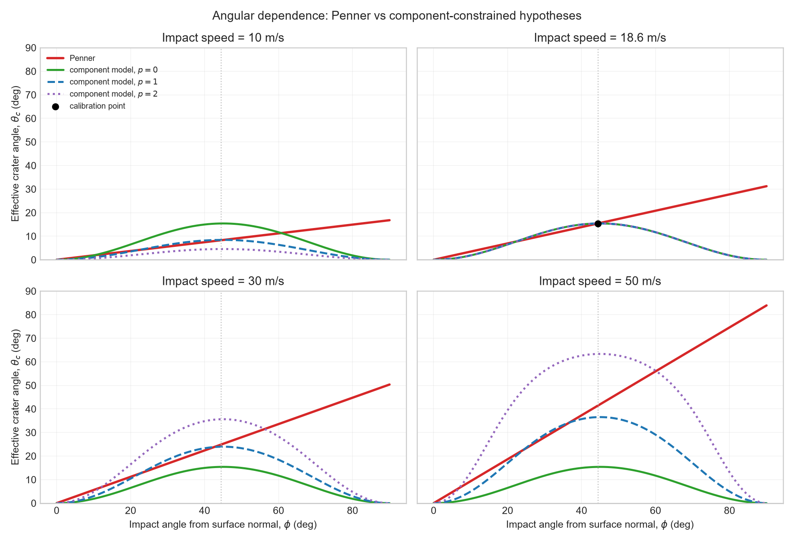
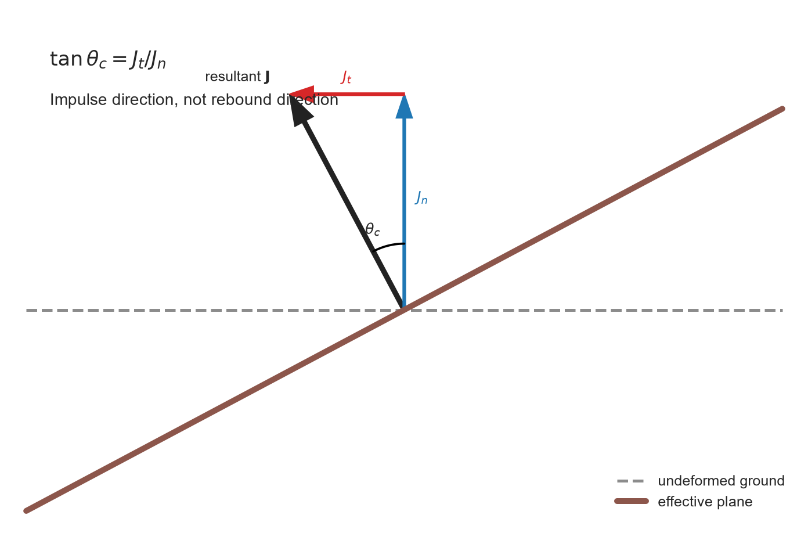
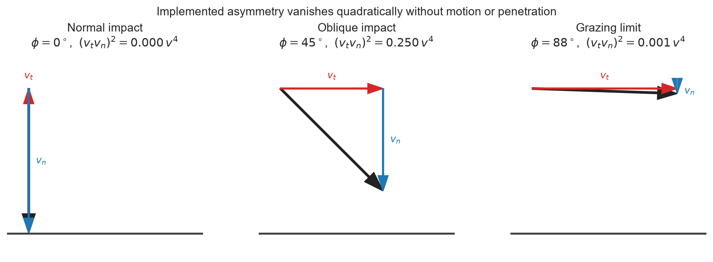
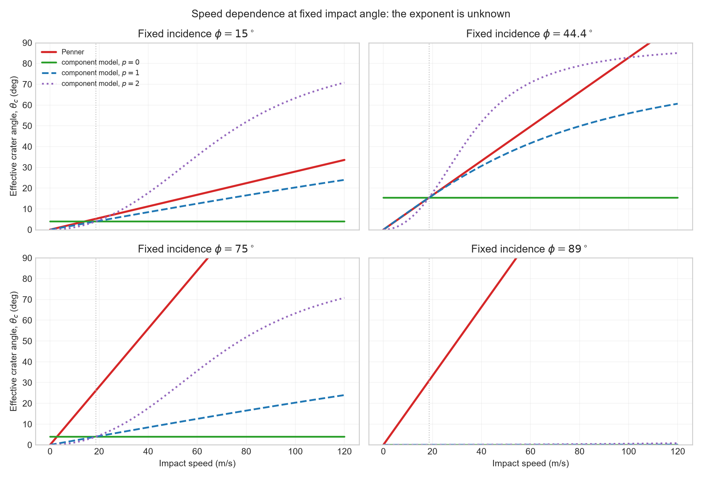

# Effective Crater Angle: Re-examining the Penner Model

This note examines the effective inclined-plane model used for the first bounce
of a golf ball on deformable turf. The boundary-constrained p=0 model described
below is now implemented in `golf_sim.py`.

Regenerate the figures from the repository root with:

```powershell
.\.venv\Scripts\python.exe .\docs\crater_model\generate_plots.py
```

## 1. Penner's model

Penner replaces compliant turf with an effective rigid plane tilted forward by
an angle $\theta_c$. From one impact case reported by Haake,

$$
v_0=18.6\ \mathrm{m\,s^{-1}},\qquad
\phi_0=44.4^\circ,\qquad
\theta_0=15.4^\circ,
$$

Penner proposed

$$
\theta_P(v,\phi)=\theta_0\frac{v}{v_0}\frac{\phi}{\phi_0}.
$$

Here $\phi$ is measured from the undeformed surface normal: zero is vertical
and 90 degrees is grazing. The formula has no domain limit. It can produce an
angle greater than 90, 360, or any other value, and gives its greatest crater
correction in the grazing limit where penetration vanishes.



## 2. Geometric meaning

The effective plane is a bookkeeping device, not necessarily the literal wall
of a crater. In the simplified calculation, the resultant contact impulse
$\mathbf J$ points along the effective plane normal. In undeformed-ground
coordinates it has normal and tangential components $J_n$ and $J_t$, so

$$
\tan\theta_c=\frac{J_t}{J_n}.
$$

This is why a tangent appears: it is the geometric ratio of impulse components.
The arctangent only converts that ratio back to a direction. It is not an
arbitrary saturation function.



$\theta_c$ is not the rebound angle. Rebound also depends on incidence,
restitution, friction, and spin. A grazing ball encountering positive
$\theta_c$ can pop upward; a vertical drop encountering it can be kicked
backward.

## 3. Boundary conditions

Resolve the incoming velocity into

$$
v_t=v\sin\phi,\qquad v_n=v\cos\phi.
$$

A replacement should satisfy:

1. zero forward asymmetry for normal impact, where $v_t=0$;
2. zero deformation correction in the exact grazing limit, where $v_n=0$;
3. a bounded, meaningful impulse direction;
4. any speed dependence must contain a material scale;
5. the complete contact law must not add energy.

The endpoint conditions must be stronger than merely $\theta_c\to0$. To make
the effective plane dynamically indistinguishable from the real plane, its
tilt must vanish faster than the incidence angle at both endpoints:

$$
\frac{\theta_c}{\phi}\to0\quad(\phi\to0),
\qquad
\frac{\theta_c}{\pi/2-\phi}\to0\quad(\phi\to\pi/2).
$$

Otherwise an apparently vanishing ramp remains a finite fraction of the
incoming angle and can reverse a nearly vertical shot or pump vertical velocity
into a sequence of grazing skips.



An initial candidate was

$$
g_1(\phi)=\frac{\sin(2\phi)}{\sin(2\phi_0)}.
$$

Although $g_1$ reaches zero at both endpoints, it does so linearly. Numerical
tests showed that it could sustain grazing skips. The asymmetric candidate
$\sin\phi\cos^2\phi$ fixed the grazing limit but remained linear near vertical
incidence and caused steep rough impacts to reverse. Both were rejected.

The implemented angular factor is quadratic at both endpoints:

$$
g(\phi)=
\frac{\sin^2\phi\cos^2\phi}
     {\sin^2\phi_0\cos^2\phi_0}
=
\frac{\sin^2(2\phi)}{\sin^2(2\phi_0)}.
$$

It is proportional to $v_t^2v_n^2/v^4$, peaks at 45 degrees, preserves the
calibration near 45 degrees, and becomes negligible relative to the incidence
angle at both vertical and grazing limits. Direction still comes from the
signed tangential unit vector used to rotate the effective normal.

## 4. Exposing the unknown speed law

One calibration point cannot identify the speed dependence. We can expose that
uncertainty with an exponent $p$:

$$
\tan\theta_c=\tan\theta_0
\left(\frac{v}{v_0}\right)^p g(\phi).
$$

All values of $p$ reproduce the sole calibration point:

- $p=0$: impulse direction depends only on incidence geometry;
- $p=1$: a momentum-like phenomenology;
- $p=2$: the earlier energy/dynamic-pressure hypothesis.

The fact that impact energy scales as $v^2$ does **not** imply that the ratio
$J_t/J_n$ scales as $v^2$. If normal and tangential contact forces scale
similarly, their ratio can be independent of speed even while both impulse
magnitudes increase. Therefore the $p=2$ curve is a hypothesis, not a result of
dimensional analysis.



For a rigid plane, $p=0$ is exact. Deformable turf may introduce speed
dependence through penetration depth, changing contact area, rate-dependent
strength, and restitution, but those require a constitutive model. Geometry
alone cannot choose $p$.

Notably, a modern campaign containing more than 1,000 golf-ball bounces found
that a **fixed effective angle** fit better than Penner's speed-and-angle law.
Neither inclined-plane model captured tangential velocity and spin especially
well. The authors identify tangential compliance and friction as missing
physics. That makes $p=0$ the least presumptive speed law for the implemented
model.

## 5. Yield, friction, and the apparent plateau

Let $J_n$ denote normal impulse and $J_t$ tangential impulse. A Coulomb sliding
law gives

$$
|J_f|\leq\mu J_n.
$$

At full slip, the *ratio* $J_f/J_n$ is fixed, not the absolute impulse. Since
$J_n$ normally grows with normal impact momentum, the allowed tangential
impulse can also grow with speed. A constant impulse direction therefore does
not mean the dirt supplies a constant resistance; it means normal and
tangential impulses grow in roughly the same proportion.

But the current simulator already applies ball-surface friction separately
after rotating the effective plane. Capping $\theta_c$ with that same friction
coefficient would mix two mechanisms and risk double-counting friction.

Actual soil failure is closer to a Mohr-Coulomb relation,

$$
\tau_y=c+\sigma_n\tan\varphi_s,
$$

where $c$ is cohesion and $\varphi_s$ is the soil's internal-friction angle.
Grass roots can add substantial cohesion without producing an equivalent
change in internal-friction angle. During a transient ball impact, contact
area, confining pressure, penetration, water content, root structure, and
strain rate all matter. There is no defensible universal "dirt angle" that can
simply be copied into $\theta_c$.

At sufficiently high speed, an angle plateau is not the right continuation
anyway. Soil excavation, fragmentation, changing contact area, and finite-time
normal and tangential compliance replace the effective-plane approximation.

## 6. Implemented model and follow-up

The simulator now uses the smallest defensible change:

$$
\tan\theta_c=\tan(15.4^\circ)\,Q C_s
\frac{\sin^2(2\phi)}{\sin^2(2\times44.4^\circ)},
$$

where $Q$ is `DEFORMATION_ASYMMETRY_SCALE` and $C_s$ is the surface
`DEFORMATION_ASYMMETRY` multiplier. They scale the tangential-to-normal
deformation impulse ratio before conversion back to an angle; neither
represents a literal simulated crater size.

`DEFORMATION_ASYMMETRY_SCALE` is currently 1.0. A temporary 4x stress test was
rejected: it made ordinary impacts nearly normal to a fictional steep plane,
causing excessive energy loss under the former normal-only restitution model
and sometimes pointing rebounds back into the true terrain. The scale remains
explicit so future angle-only tuning does not require changing every surface.

Active surface multipliers are deliberately below the original calibration:
rough 0.30, fairway/tee 0.40, green 0.35, and bunker/water 0.00. At roughly
45-degree incidence this gives about 4.7 degrees of effective-plane tilt on
rough, 6.3 degrees on fairway, and 5.5 degrees on green. Rough absorbs more
energy through restitution and resistance but supplies less coherent ramp-like
redirection; this keeps uphill and strong-backspin reversals possible without
making ordinary rough wedge shots reverse too readily. Green rebound energy
is controlled separately by low directional restitution; the modestly larger
rotation raises the exit direction without making it a trampoline.
The angular kernel remains normalized to Haake's calibration point when the
combined global and surface multiplier is 1.0. Active surface multipliers are
all lower, so no current surface reproduces 15.4 degrees. Tests cover speed
independence, quadratic vertical and grazing limits, the 45-degree peak, the
active green multiplier, and exact vertical impacts. The former blanket
non-reversal assertion was removed: a rotated effective plane can physically
redirect some oblique impacts backward, although the reduced active surface
multipliers make routine reversals much less likely.

This removes Penner's unbounded extrapolation and satisfies the endpoint
geometry without inventing a speed exponent or guessed yield angle. A separate
cutoff is not currently required for mathematical boundedness, but whether turf
needs an independently calibrated critical/yield angle remains an open design
question. Subjective gameplay testing found the quadratic-endpoint model
materially better behaved than the linear-endpoint candidate.

Spin-dependent friction remains active during each bounce. Low rebounds now
enter an explicit ground-constrained skid phase before ideal rolling; see
[`../SPIN_BOUNCE_AND_SKID.md`](../SPIN_BOUNCE_AND_SKID.md).

## Sources

- A. R. Penner, *The run of a golf ball* (2002):
  <https://www.raypenner.com/golf-run.pdf>
- S. W. Biber, PhD thesis (2023), discussion of Penner's single calibration
  point: <https://research-information.bris.ac.uk/ws/portalfiles/portal/379784795/Final_Copy_2023_10_03_Biber_S_W_PhD.pdf>
- S. W. Biber et al., *Measurements and linearized models for golf ball
  bounce* (2023): <https://arxiv.org/abs/2302.02758>
- S. W. Biber, A. R. Champneys, and R. Szalai, *Analysis of point-contact
  models of the bounce of a hard spinning ball on a compliant frictional
  surface* (2022): <https://arxiv.org/abs/2208.11685>
- H. Li et al., direct shear tests of Bermuda-grass/root reinforced soil
  (2019): <https://doi.org/10.1016/j.geotexmem.2019.103491>

